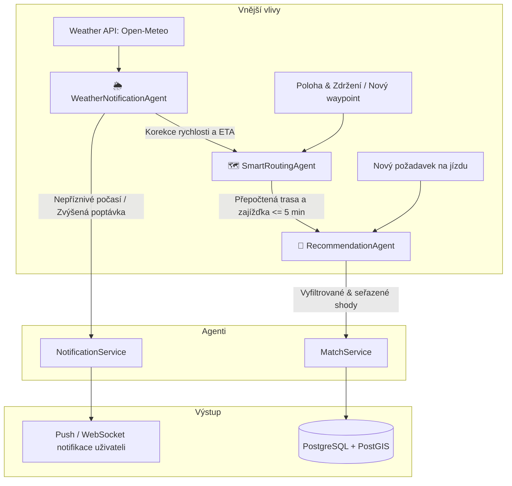

# AGENTS.md — SpolujízdaNaPožádání (EBC-WAB)

Tento dokument slouží jako **hlavní architektonický manuál a specifikace pro AI agenty i lidské vývojáře** pracující na projektu **SpolujízdaNaPožádání**.

Dokument definuje:
1. **Pravidla a instrukce pro AI kódovací agenty** (coding conventions, vrstvy Spring Boot, best practices).
2. **Architekturu doménových / chytrých agentů** v aplikaci:
   - 🌦️ **WeatherNotificationAgent** (notifikace odvozu podle počasí, dynamické časové rezervy).
   - 🗺️ **SmartRoutingAgent** (koridorové plánování, vyzvednutí na trase s limitem zajížďky, dynamické přepočítávání).
   - 🤝 **RecommendationAgent** (doporučování a párování podle preferencí, pohlaví / women-only, ratingu a důvěry).

---

## 1. Architektonický přehled a technologický stack

Projekt je koncipován jako backendová služba v **Java 21 / Spring Boot 3.x** s důrazem na čistou vrstvenou architekturu, asynchronní zpracování událostí a geoprostorové výpočty.

### Technologický stack:
- **Jazyk & Platforma:** Java 21 (LTS), Spring Boot 3.3+
- **Databáze:** Neon Serverless PostgreSQL 16 + rozšíření **PostGIS** (sdílená cloudová databáze pro tým, databázový branching, geometrie, koridory, prostorové indexy `GIST`)
- **Cache & Real-time:** Redis 7 (živá poloha, rate-limiting, pub/sub pro WebSockety)
- **Migrace schématu:** Flyway (verzování sdíleného datového modelu)
- **Messaging / Events:** Spring Application Events (in-memory) / Redis Streams nebo RabbitMQ pro asynchronní zprávy
- **Routování & Mapy:** OSRM (Open Source Routing Machine) / OpenRouteService REST API
- **Počasí:** Open-Meteo API / OpenWeatherMap API (free tier, spolehlivé REST rozhraní bez nutnosti API klíče u Open-Meteo)
- **Komunikace s klientem:** REST (JSON) + WebSocket (STOMP) pro živou polohu a okamžité notifikace
- **Testování:** JUnit 5, Mockito, AssertJ, Testcontainers (PostgreSQL + PostGIS, Redis)

---

## 2. Standardní struktura projektu (Controller - Service - Repository)

Kód důsledně dodržuje konvence Spring Boot. Žádná byznys logika nesmí unikat do Controllerů ani Repozitářů.

```
d:/Blablacar/
├── src/
│   ├── main/
│   │   ├── java/cz/vutbr/feec/spolujizda/
│   │   │   ├── SpolujizdaApplication.java
│   │   │   │
│   │   │   ├── agent/                     # Doménoví chytří agenti (orchestrace, rozhodování)
│   │   │   │   ├── weather/
│   │   │   │   │   ├── WeatherNotificationAgent.java
│   │   │   │   │   └── WeatherConditionEvaluator.java
│   │   │   │   ├── routing/
│   │   │   │   │   ├── SmartRoutingAgent.java
│   │   │   │   │   └── DetourCalculator.java
│   │   │   │   └── recommendation/
│   │   │   │       ├── RecommendationAgent.java
│   │   │   │       └── MatchScorer.java
│   │   │   │
│   │   │   ├── controller/                # REST Controller & WebSocket Endpoints
│   │   │   │   ├── AuthController.java
│   │   │   │   ├── RideOfferController.java
│   │   │   │   ├── RideRequestController.java
│   │   │   │   ├── MatchController.java
│   │   │   │   ├── TrackingController.java     # WebSocket STOMP
│   │   │   │   └── UserController.java
│   │   │   │
│   │   │   ├── service/                   # Byznys logika, transakce, integrace
│   │   │   │   ├── RideOfferService.java
│   │   │   │   ├── RideRequestService.java
│   │   │   │   ├── MatchingService.java
│   │   │   │   ├── RoutingService.java        # OSRM klient
│   │   │   │   ├── WeatherService.java        # Weather API klient
│   │   │   │   ├── NotificationService.java   # Push / Email / WS dispatch
│   │   │   │   └── UserService.java
│   │   │   │
│   │   │   ├── repository/                # Spring Data JPA + PostGIS native queries
│   │   │   │   ├── UserRepository.java
│   │   │   │   ├── VehicleRepository.java
│   │   │   │   ├── RideOfferRepository.java
│   │   │   │   ├── RideRequestRepository.java
│   │   │   │   ├── MatchRepository.java
│   │   │   │   └── RatingRepository.java
│   │   │   │
│   │   │   ├── model/                     # JPA Entity a Enumy
│   │   │   │   ├── entity/
│   │   │   │   │   ├── User.java
│   │   │   │   │   ├── Vehicle.java
│   │   │   │   │   ├── RideOffer.java         # obsahuje LineString trasy v PostGIS
│   │   │   │   │   ├── RideRequest.java       # obsahuje Point pickup & dropoff
│   │   │   │   │   ├── Match.java
│   │   │   │   │   ├── Trip.java
│   │   │   │   │   └── Rating.java
│   │   │   │   └── enums/
│   │   │   │       ├── MatchStatus.java
│   │   │   │       ├── Gender.java
│   │   │   │       ├── GenderPreference.java  # ANY, WOMEN_ONLY, SAME_GENDER
│   │   │   │       └── RideStatus.java
│   │   │   │
│   │   │   ├── dto/                       # Record DTOs (Request / Response)
│   │   │   │   ├── request/
│   │   │   │   └── response/
│   │   │   │
│   │   │   ├── event/                     # Události pro decoupling služeb a agentů
│   │   │   │   ├── RideRequestedEvent.java
│   │   │   │   ├── RideOfferCreatedEvent.java
│   │   │   │   ├── MatchSuggestedEvent.java
│   │   │   │   ├── WeatherAlertEvent.java
│   │   │   │   └── RouteRecalculatedEvent.java
│   │   │   │
│   │   │   └── config/                    # Security, PostGIS Jackson, WebSockets, Async
│   │   │       ├── SecurityConfig.java
│   │   │       ├── WebSocketConfig.java
│   │   │       ├── AsyncConfig.java
│   │   │       └── JacksonGeoConfig.java
│   │   │
│   │   └── resources/
│   │       ├── application.yml
│   │       └── db/migration/              # Flyway SQL migrace
│   │           ├── V1__init_schema.sql
│   │           └── V2__postgis_indexes.sql
│   │
│   └── test/
│       └── java/cz/vutbr/feec/spolujizda/
└── AGENTS.md
```

---

## 3. Detailní specifikace chytrých agentů (Smart Domain Agents)

Chytří agenti jsou autonomní doménové komponenty (`@Component` / `@Service`), které reagují na události (Events), periodické plány (`@Scheduled`), nebo externí triggery a provádějí heuristické / analytické rozhodování.



---

### 3.1 🌦️ WeatherNotificationAgent (Počasí & Notifikace)

#### Motivace a účel:
Spolujízda na požádání je silně závislá na počasí. Když začne pršet, sněžit nebo mrznout, poptávka po odvozu prudce stoupá (lidé nechtějí čekat na zastávkách MHD nebo jít pěšky), zatímco cestovní rychlost klesá.
Tento agent proaktivně monitoruje meteorologické podmínky v zájmové oblasti (např. kampus, univerzitní koridor, město) a automaticky reaguje.

#### Zodpovědnost:
1. **Předpověď & detekce zhoršeného počasí:**
   - Každých 15–30 minut (`@Scheduled`) dotazuje Open-Meteo pro koordináty klíčových bodů.
   - Sleduje parametry: déšť (`precipitation > 1.0 mm/h`), sněžení, náledí (`temp < 1°C` + srážky), silný vítr.
2. **Proaktivní Smart Notifikace:**
   - Pokud se blíží déšť v horizontu 30–60 minut:
     - Osloví registrované pasažéry, kteří v tomto čase obvykle cestují nebo mají uložený draft cesty: *"Za 30 minut bude pršet. V tvém směru jede řidič Tomáš, chceš se svézt?"*
     - Notifikuje řidiče: *"Vzhledem k dešti je na trase zvýšený zájem o svezení."*
3. **Korekce ETA a časových oken:**
   - Při špatném počasí agent navyšuje odhadovaný čas cesty o dynamický koeficient (např. +15 % při dešti, +30 % při sněhu), aby nedocházelo k propadnutí časových oken pro vyzvednutí.

#### Technická implementace ve Spring Boot:
- Třída: `cz.vutbr.feec.spolujizda.agent.weather.WeatherNotificationAgent`
- Vstupy: `WeatherService` (Open-Meteo REST klient), `RideOfferRepository`, `RideRequestRepository`, `NotificationService`.
- Výstup: Publikování `WeatherAlertEvent`, odeslání push notifikací přes WebSocket / FCM.

```java
@Component
@RequiredArgsConstructor
@Slf4j
public class WeatherNotificationAgent {

    private final WeatherService weatherService;
    private final RideRequestRepository requestRepository;
    private final NotificationService notificationService;
    private final ApplicationEventPublisher eventPublisher;

    @Scheduled(cron = "0 */15 * * * *") // Každých 15 minut
    public void evaluateWeatherAndTriggerAlerts() {
        WeatherCondition condition = weatherService.getCurrentAndNearForecast();
        
        if (condition.isAdverseWeather()) {
            log.info("Adverse weather detected: {}. Triggering smart notifications.", condition.getDescription());
            
            eventPublisher.publishEvent(new WeatherAlertEvent(condition));
            
            // Vyhledat pasažéry s pending poptávkou nebo častou trasou
            List<User> targetUsers = requestRepository.findUsersWaitingForRides();
            for (User user : targetUsers) {
                notificationService.sendWeatherRidePrompt(user, condition);
            }
        }
    }
}
```

---

### 3.2 🗺️ SmartRoutingAgent (Chytré přepočítávání trasy & vyzvednutí po cestě)

#### Motivace a účel:
Řidič nesmí dělat velké zajížďky (zadání striktně požaduje: **zajížďka v limitu, např. do 5 minut**). 
SmartRoutingAgent dynamicky vyhodnocuje, zda lze nového pasažéra nabrat po cestě s minimální časovou a prostorovou odchylkou od původní trasy řidiče.

#### Zodpovědnost:
1. **Geometrický koridor (PostGIS):**
   - Při vytvoření nabídky jízdy (`RideOffer`) se trasa z OSRM uloží jako `LineString` (EPSG:4326).
   - Agent vytváří prostorový polygon (buffer, např. 500 metrů kolem trasy): `ST_Buffer(ST_Transform(route_geom, 3857), 500)`.
   - Rychlé předfiltrování v databázi: Pasažérův nástupní i výstupní bod musí ležet uvnitř nebo v těsné blízkosti koridoru.
2. **Přepočet s vloženým bodem (Waypoint Insertion & Detour Calculation):**
   - Pro kandidáty z koridoru agent spočítá přesnou časovou ztrátu:
     $$\Delta t = t(\text{Start} \to \text{Pickup} \to \text{Dropoff} \to \text{Cíl}) - t(\text{Start} \to \text{Cíl})$$
   - Pokud $\Delta t \le \text{maxDetourMinutes}$ (výchozí 5 min), je nabídka validní.
3. **Dynamické přeplánování při zdržení (Dynamic Rerouting):**
   - Pokud řidič uvízne v koloně nebo zvolí alternativní ulici, agent přepočítá koridor a odhadovaný čas vyzvednutí (ETA). Pokud by zpoždění přesáhlo limit, notifikuje pasažéra i řidiče.

#### Technická implementace:
- Třída: `cz.vutbr.feec.spolujizda.agent.routing.SmartRoutingAgent`
- Nástroje: `RoutingService` (klient OSRM API `/route/v1/driving/`), PostGIS spatial repozitář.

```java
@Component
@RequiredArgsConstructor
@Slf4j
public class SmartRoutingAgent {

    private final RoutingService routingService;
    private static final int MAX_DETOUR_MINUTES = 5;

    public DetourEvaluation evaluatePickupOnTheWay(RideOffer offer, Point passengerPickup, Point passengerDropoff) {
        // 1. Získání základní doby původní trasy
        int originalDurationSec = offer.getOriginalDurationSeconds();

        // 2. Výpočet nové trasy s vloženými body přes OSRM
        Route recalculated = routingService.calculateRoute(List.of(
            offer.getStartPoint(),
            passengerPickup,
            passengerDropoff,
            offer.getEndPoint()
        ));

        int newDurationSec = recalculated.getDurationSeconds();
        int detourMinutes = (newDurationSec - originalDurationSec) / 60;

        boolean isAcceptable = detourMinutes <= Math.min(offer.getMaxDetourMinutes(), MAX_DETOUR_MINUTES);

        return new DetourEvaluation(isAcceptable, detourMinutes, recalculated.getGeometry());
    }
}
```

---

### 3.3 🤝 RecommendationAgent (Doporučování podle pohlaví, ratingu a důvěry)

#### Motivace a účel:
Spolujízda je postavena na **bezpečnosti a důvěře**. Zejména ve studentských a komunitních sítích je klíčové:
- Možnost volby preferencí (např. **ženy chtějí jezdit se ženami** – funkce Women-Only / Safe Ride).
- Preferování řidičů a pasažérů s **vysokým hodnocením (rating)** a nízkým poměrem zrušených jízd.
- Prioritizace uživatelů ze stejné komunity / fakulty.

RecommendationAgent není jen jednoduchý SQL filtr, ale **skórovací engine**, který přiřadí každému možnému spárování vážené skóre důvěry a kompatibility.

#### Skórovací heuristika:
Pro kandidátní pár (Řidič $D$, Pasažér $P$) se počítá $Score \in [0, 100]$:

$$Score = w_1 \cdot S_{\text{time}} + w_2 \cdot S_{\text{detour}} + w_3 \cdot S_{\text{rating}} + w_4 \cdot S_{\text{trust}} + w_5 \cdot S_{\text{community}}$$

Kde:
- **$S_{\text{gender}}$ (Tvrdá podmínka / Filtr):**
  - Pokud má pasažérka nebo řidička nastaveno `WOMEN_ONLY`, kandidáti opačného pohlaví jsou **okamžitě vyřazeni** ($Score = 0$).
  - Pokud je preference `SAME_GENDER`, akceptují se pouze stejná pohlaví.
  - Pokud je `ANY`, podmínka je splněna.
- **$S_{\text{rating}}$ (Váha 25 %):** Průměrné hodnocení řidiče a pasažéra (1.0–5.0 přepočteno na 0–100). Uživatelé s ratingem $< 3.5$ nebo opakovanými nahlášeními mají výraznou penalizaci.
- **$S_{\text{detour}}$ (Váha 30 %):** Menší zajížďka = vyšší skóre (0 min = 100 b, 5 min = 20 b).
- **$S_{\text{time}}$ (Váha 25 %):** Časová shoda s preferovaným odjezdem.
- **$S_{\text{community}}$ (Váha 20 %):** Bonus za ověřený univerzitní e-mail stejné fakulty / stejné pracoviště / vzájemné pozitivní jízdy v minulosti.

#### Technická implementace:
- Třída: `cz.vutbr.feec.spolujizda.agent.recommendation.RecommendationAgent`

```java
@Component
@RequiredArgsConstructor
@Slf4j
public class RecommendationAgent {

    private final SmartRoutingAgent routingAgent;
    private final MatchScorer matchScorer;

    public List<ScoredMatch> rankMatches(RideRequest request, List<RideOffer> candidateOffers) {
        return candidateOffers.stream()
            // 1. Tvrdý bezpečnostní filtr (pohlaví & preference)
            .filter(offer -> isGenderCompatible(offer.getDriver(), request.getPassenger(), 
                                               request.getGenderPreference(), offer.getGenderPreference()))
            // 2. Minimální práh spolehlivosti
            .filter(offer -> offer.getDriver().getReputationScore() >= 3.0)
            // 3. Výpočet zajížďky přes SmartRoutingAgent
            .map(offer -> {
                DetourEvaluation detour = routingAgent.evaluatePickupOnTheWay(
                    offer, request.getPickupPoint(), request.getDropoffPoint());
                if (!detour.isAcceptable()) return null;
                
                double score = matchScorer.calculateScore(offer, request, detour);
                return new ScoredMatch(offer, request, detour, score);
            })
            .filter(Objects::nonNull)
            // 4. Seřazení od nejlepšího doporučení
            .sorted(Comparator.comparingDouble(ScoredMatch::getScore).reversed())
            .toList();
    }

    private boolean isGenderCompatible(User driver, User passenger, 
                                       GenderPreference passengerPref, GenderPreference driverPref) {
        if (passengerPref == GenderPreference.WOMEN_ONLY) {
            if (driver.getGender() != Gender.FEMALE) return false;
        }
        if (driverPref == GenderPreference.WOMEN_ONLY) {
            if (passenger.getGender() != Gender.FEMALE) return false;
        }
        return true;
    }
}
```

---

## 4. Pravidla pro AI agenty při generování a úpravách kódu (Coding Guidelines)

Při implementaci nových tříd a rozšiřování kódu **MUSÍ** každý AI agent dodržovat následující standardy:

### 4.1 Architektonická integrita:
1. **Controller (`@RestController`):**
   - Zodpovídá pouze za validaci vstupů (`@Valid`), mapování HTTP kódů a delegaci do `Service`.
   - Vrací zásadně `ResponseEntity<T>` s DTO objekty, **nikdy nevrací přímo JPA entity**.
2. **Service (`@Service`):**
   - Obsahuje byznys transakce (`@Transactional`).
   - Volá agenty pro složitá rozhodování (routing, scoring, weather).
   - Publikuje aplikační události (`eventPublisher.publishEvent(...)`).
3. **Repository (`@Repository`):**
   - Využívá Spring Data JPA.
   - Pro geoprostorové dotazy používá nativní SQL PostGIS funkce (`ST_DWithin`, `ST_Intersects`, `ST_MakePoint`).
   - Prostorové parametry jsou vždy v WGS84 (SRID 4326).
4. **DTOs:**
   - Všechna DTO jsou deklarována jako neměnné Java `record`.
   - Vstupy opatřeny validačními anotacemi (`@NotNull`, `@Min`, `@Size`).

### 4.2 Bezpečnost, GDPR a ochrana soukromí:
- **Živá poloha:** Ukládá se v Redisu s TTL (časem expirace). Do trvalé databáze se neukládají přesné trajektorie po dokončení cesty.
- **Přesné adresy:** V návrzích se zobrazují pouze orientační záchytné body (meeting points), přesná poloha řidiče je viditelná až po vzájemném potvrzení a zahájení jízdy.
- **PIN kód:** Každé zahájení jízdy vyžaduje zadání 4místného jednorázového OTP kódu (nástup do správného vozidla).
- **SOS:** Endpoint `/api/v1/trips/{id}/sos` má nejvyšší prioritu, okamžitě emituje zprávu na WebSocket a SMS/notifikaci důvěryhodným kontaktům.

### 4.3 Příklad struktury PostGIS repozitáře:
```java
public interface RideOfferRepository extends JpaRepository<RideOffer, UUID> {

    @Query(value = """
        SELECT r.* FROM ride_offers r
        WHERE r.status = 'ACTIVE'
          AND r.available_seats >= :seats
          AND ST_DWithin(r.route_corridor, ST_SetSRID(ST_MakePoint(:pickupLon, :pickupLat), 4326), :bufferMeters)
          AND ST_DWithin(r.route_corridor, ST_SetSRID(ST_MakePoint(:dropoffLon, :dropoffLat), 4326), :bufferMeters)
          AND r.departure_time BETWEEN :windowStart AND :windowEnd
        """, nativeQuery = true)
    List<RideOffer> findCandidatesInCorridor(
        @Param("pickupLon") double pickupLon,
        @Param("pickupLat") double pickupLat,
        @Param("dropoffLon") double dropoffLon,
        @Param("dropoffLat") double dropoffLat,
        @Param("bufferMeters") double bufferMeters,
        @Param("seats") int seats,
        @Param("windowStart") LocalDateTime windowStart,
        @Param("windowEnd") LocalDateTime windowEnd
    );
}
```

---

## 5. Databázová strategie: Neon Console, PostGIS a týmové sdílení modelu

Projekt využívá cloudovou serverless PostgreSQL službu **Neon** ([neon.tech](https://neon.tech/)).

### 5.1 Proč Neon Console pro studentský / týmový projekt:
1. **Jednotná sdílená databáze:** Celý tým se připojuje ke stejné instanci v cloudu. Odpadá nutnost lokální instalace PostgreSQL a manuálního kompilování/instalování rozšíření PostGIS na různých operačních systémech (Windows/macOS/Linux).
2. **Databázový Branching (Větvení):** Neon umožňuje vytvořit okamžitou kopii (branch) hlavní databáze (např. `main` vs. `dev-feature-routing`). Vývojář může otestovat Flyway migraci nebo destruktivní změny na své větvi bez obav, že rozbije data kolegům.
3. **Plná podpora PostGIS:** PostGIS je v Neonu dostupný a stačí jej aktivovat.

### 5.2 Inicializace PostGIS v Neonu:
V Neon SQL Editoru (Console) nebo v první Flyway migraci (`V1__init_postgis.sql`) musí být spuštěn příkaz:
```sql
CREATE EXTENSION IF NOT EXISTS postgis;
```

### 5.3 Zákaz `ddl-auto: update` & Striktní verzování přes Flyway:
> [!CAUTION]
> **Nikdy nepoužívejte `spring.jpa.hibernate.ddl-auto=update` ani `create-drop` na sdílené Neon databázi!**
> Mohlo by dojít k nechtěnému smazání tabulek vytvořených jiným členem týmu nebo k nekonzistentnímu schématu.

- V konfiguraci je striktně nastaveno: `ddl-auto: validate`.
- Veškeré změny tabulek, sloupců, prostorových indexů a enumů probíhají **výhradně přes migrační skripty Flyway** v adresáři:
  `src/main/resources/db/migration/V{verze}__{popis}.sql`
- Příklad migrace pro geometrie s prostorovým indexem:
  ```sql
  -- V2__create_ride_offers.sql
  CREATE TABLE ride_offers (
      id UUID PRIMARY KEY DEFAULT gen_random_uuid(),
      driver_id UUID NOT NULL REFERENCES users(id),
      route_geometry GEOMETRY(LineString, 4326) NOT NULL,
      route_corridor GEOMETRY(Polygon, 4326),
      departure_time TIMESTAMP WITH TIME ZONE NOT NULL,
      available_seats INT NOT NULL CHECK (available_seats >= 1),
      max_detour_minutes INT NOT NULL DEFAULT 5,
      status VARCHAR(32) NOT NULL DEFAULT 'ACTIVE',
      created_at TIMESTAMP WITH TIME ZONE DEFAULT NOW()
  );

  -- Prostorový GIST index pro bleskové ST_DWithin / ST_Intersects dotazy
  CREATE INDEX idx_ride_offers_corridor_gist ON ride_offers USING GIST (route_corridor);
  CREATE INDEX idx_ride_offers_geometry_gist ON ride_offers USING GIST (route_geometry);
  ```

### 5.4 Konfigurace Spring Boot (`application.yml` a proměnné prostředí):
Neon vyžaduje zabezpečené SSL připojení (`sslmode=require`). Citlivá hesla se **nikdy necommitují do Gitu**. Používají se proměnné prostředí nebo `.env` soubor:

```yaml
spring:
  datasource:
    url: jdbc:postgresql://${NEON_HOST:ep-example-123456.eu-central-1.aws.neon.tech}/${NEON_DB:neondb}?sslmode=require
    username: ${NEON_USER}
    password: ${NEON_PASSWORD}
    driver-class-name: org.postgresql.Driver
    hikari:
      maximum-pool-size: 5       # Neon je serverless, pool držíme na rozumné úrovni
      minimum-idle: 1
      idle-timeout: 300000
      max-lifetime: 600000
      connection-timeout: 30000
  
  jpa:
    open-in-view: false
    hibernate:
      ddl-auto: validate         # Validuje model vůči Neon DB, žádné automatické zásahy
    properties:
      hibernate:
        format_sql: true
        jdbc:
          time_zone: UTC

  flyway:
    enabled: true
    baseline-on-migrate: true
    locations: classpath:db/migration
```

### 5.5 Týmový workflow s větvemi (Branching Workflow):
1. **Produkční / společná větev (`main`):** Obsahuje aktuální schéma a testovací sadu dat pro celý tým.
2. **Feature větev v Neonu:** Pokud vývojář přidává novou tabulku nebo upravuje sloupce:
   - V Neon Console vytvoří novou větev (např. `branch-smart-routing`).
   - Nastaví si connection string v lokálním `.env` na tuto větev.
   - Napíše Flyway migraci a ověří, že Spring Boot bez chyb nastartuje.
   - Po schválení merge requestu v Gitu proběhne migrace na hlavní větvi Neonu.

---

## 6. REST & WebSocket API Kontrakt (Přehled)

> [!TIP]
> **Swagger UI / OpenAPI Dokumentace:**
> Kompletní interaktivní dokumentace všech REST endpointů je dostupná na:
> - **Swagger UI:** `http://localhost:8080/swagger-ui.html`
> - **OpenAPI JSON specifikace:** `http://localhost:8080/v3/api-docs`

### REST Endpoints
| Metoda | Endpoint | Účel | Popis |
|---|---|---|---|
| `POST` | `/api/v1/offers` | Vytvoření nabídky jízdy | Spočítá OSRM trasu, uloží koridor PostGIS |
| `POST` | `/api/v1/requests` | Vytvoření poptávky | Spustí `RecommendationAgent` a vrátí seřazené nabídky |
| `POST` | `/api/v1/matches/{id}/accept` | Přijetí nabídky | Změna stavu na `ACCEPTED`, generování OTP kódu |
| `POST` | `/api/v1/trips/{id}/verify-otp` | Ověření nástupu | Řidič potvrdí kód z mobilu pasažéra |
| `POST` | `/api/v1/trips/{id}/finish` | Dokončení jízdy | Zpřístupní formulář hodnocení, smaže živé piny |
| `POST` | `/api/v1/trips/{id}/sos` | Nouzový signál | Okamžitý push kontaktům |
| `GET`  | `/api/v1/weather/current-impact` | Diagnostika počasí | Aktuální stav vyhodnocený `WeatherNotificationAgent` |

### WebSocket (STOMP)
- `/topic/trip/{tripId}/location` — příjem živé polohy vozidla (interval 3–5s).
- `/user/queue/notifications` — privátní zprávy pro uživatele (např. *"Pasažér čeká"*, *"Blíží se déšť"*).

---

## 7. Checklist pro AI Agenty před commitem / dokončením úlohy:
- [ ] Jsou všechny třídy umístěny ve správných balíčcích dle architektury (Controller - Service - Repository - Agent)?
- [ ] Je dodržena separace odpovědnosti (Controller neobsahuje SQL ani výpočetní algoritmy)?
- [ ] Jsou nové entity opatřeny prostorovými indexy (`GIST`) v příslušné Flyway migraci?
- [ ] Byly změny schématu otestovány v samostatné Neon větvi nebo přes Flyway migraci bez porušení `ddl-auto: validate`?
- [ ] Neobsahuje kód žádná hardcodovaná přístupová hesla k Neon databázi?
- [ ] Jsou zohledněny filtry pohlaví (`WOMEN_ONLY`) a bezpečnostní rating při jakémkoliv párování?
- [ ] Jsou napsány příslušné Unit / Integration testy pro nové komponenty?

