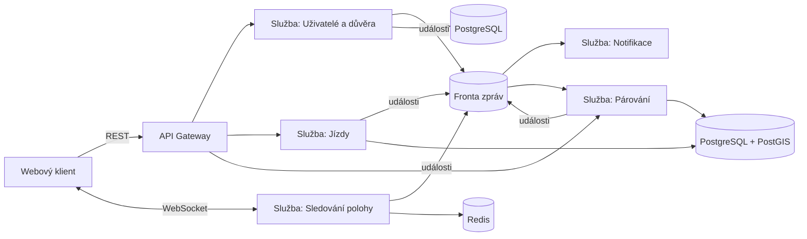
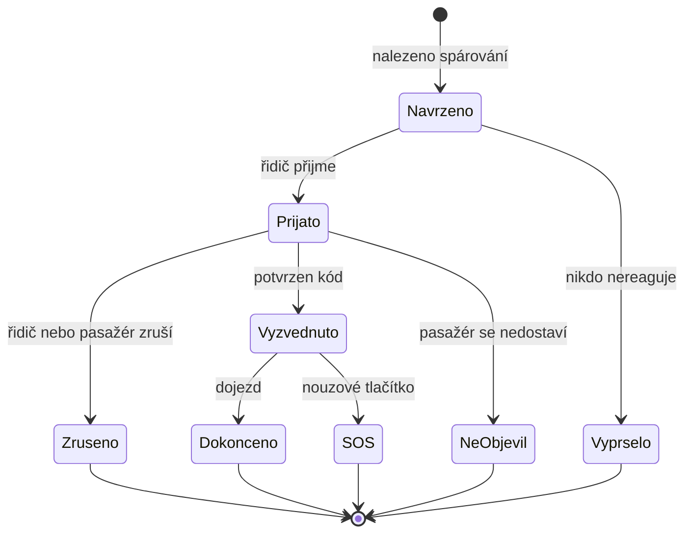
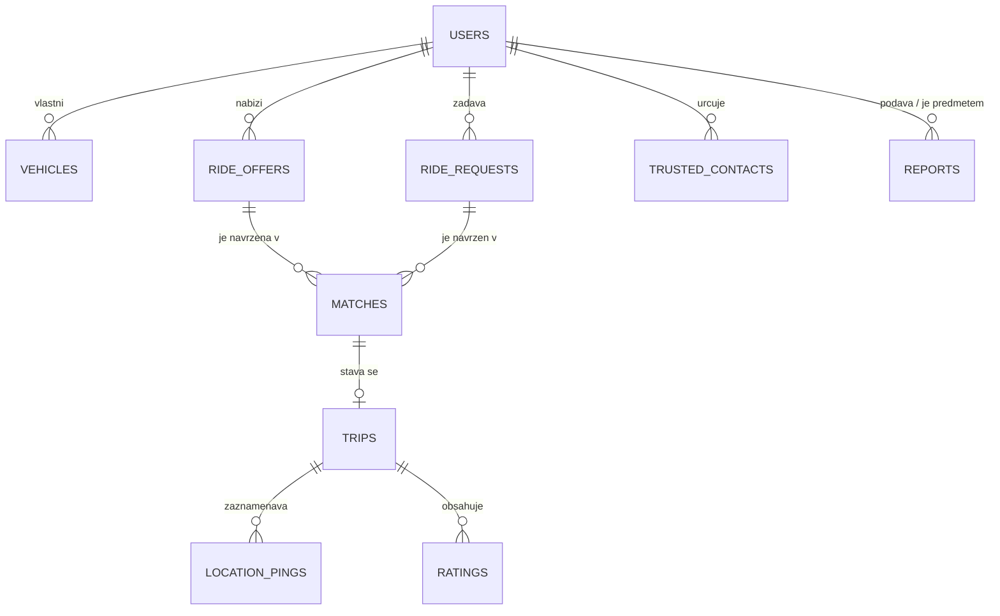

# SpolujízdaNaPožádání (pracovní název)

> Zadání projektu EBC-WAB, 1. část. Tým: *(doplnit jména)*

Bezplatná komunitní spolujízda „na požádání“: řidič, který už jede, nabídne volná místa, a někdo, kdo potřebuje jet stejným směrem v nejbližší hodině, se k němu připojí jedním klikem. Bez plateb, jen sdílení cesty, s důrazem na bezpečnost.

## 1. Problém a uživatelé

**Problém.** Spousta lidí jezdí městem a regionem sama v autě, zatímco jiní stejnou cestu řeší MHD s přestupy nebo drahým taxíkem. Existující služby nepomáhají:

- **BlaBlaCar, Hopin** míří na dlouhé trasy plánované s předstihem. Na krátkou cestu „za hodinu“ se nehodí.
- **Uber, Bolt, Grab** jsou placené taxislužby, kde řidič jede kvůli výdělku.
- **Facebook skupiny a WhatsApp** jsou nestrukturované, bez ověření identity a bez jakékoli ochrany při problému.

**Uživatelé.**

| Role | Co dnes dělá | Co chce |
|---|---|---|
| Řidič | Jezdí sám, auto je poloprázdné | Vzít cestou někoho bez zajížďky a bez starostí |
| Spolucestující | Čeká na MHD, platí taxi, nebo se ptá známých | Rychle se dostat z A do B, bezpečně a zdarma |

**Pro koho v prvním nasazení.** Jedna uzavřená komunita (např. studenti a zaměstnanci jedné školy) a jedna typická trasa. Tím řešíme problém „prázdného marketplace“ a zjednodušujeme ověřování.

## 2. Hlavní scénáře

1. **Řidič zveřejní jízdu.** Zadá start, cíl, čas odjezdu a počet volných míst. Systém spočítá trasu a uloží ji jako koridor.
2. **Spolucestující zadá požadavek.** Zadá odkud, kam a časové okno. Systém vrátí řidiče, jejichž trasa vede kolem a zajížďka je v limitu (např. do 5 minut).
3. **Domluva a vyzvednutí.** Řidič jedním klikem přijme. Oba vidí jméno, fotku, SPZ a místo setkání. Při vyzvednutí si potvrdí jednorázový kód, aby nenastoupil do špatného auta.
4. **Jízda a dokončení.** Po dobu jízdy je živá poloha viditelná jen účastníkům a určenému důvěryhodnému kontaktu. K dispozici je SOS tlačítko. Po dojezdu následuje vzájemné hodnocení a poloha se smaže.

## 3. Bezpečnost a ochrana proti zneužití

| Riziko | Opatření |
|---|---|
| Falešné identity | Registrace jen přes ověřený školní/firemní e-mail, ověření telefonu, u řidiče evidence vozidla (SPZ) |
| Neznámý řidič nebo pasažér | Veřejný profil: počet jízd, hodnocení, historie nahlášení |
| Nástup do špatného auta | Jednorázový kód potvrzený při vyzvednutí |
| Něco se stane za jízdy | Sdílení polohy s důvěryhodným kontaktem, SOS tlačítko, záznam průběhu jízdy |
| Stalking a únik polohy | Přesné adresy se nezobrazují, jen místa setkání. Poloha viditelná jen účastníkům. Po jízdě se maže |
| Spam a trolling | Rate limity, blokování uživatelů, automatický ban po opakovaných nahlášeních |
| Právní odpovědnost | Podmínky: sdílení nákladů bez zisku, žádná záruka, ne taxislužba |

„Veřejné“ znamená transparentní (profily, hodnocení, pravidla), ne veřejně viditelná poloha.

## 4. Architektura

### Služby a důvod dělení

| Služba | Odpovědnost | Proč samostatně |
|---|---|---|
| **Uživatelé a důvěra** | Registrace, ověření, profily, hodnocení, nahlášení, blokace | Citlivá osobní data, přísnější zabezpečení, odlišný životní cyklus |
| **Jízdy** | Nabídky, požadavky, životní cyklus jízdy (stavový automat) | Jádro domény, vlastní datový model |
| **Párování** | Geo a časový výpočet: které nabídky odpovídají požadavku | Výpočetně náročné, škáluje se jinak než běžné CRUD |
| **Sledování polohy** | Příjem poloh, živé sdílení, SOS | Vysoká frekvence zápisů, nesmí při špičce shodit zbytek |
| **Notifikace** | Push, e-mail, SMS (zejména SOS) | Musí být spolehlivá a asynchronní, externí poskytovatelé jsou nespolehliví |

### Komunikace a proč

- **REST** mezi klientem a službami: standardní operace (profily, vytvoření nabídky, přijetí).
- **Fronta zpráv** (RabbitMQ nebo Redis Streams) pro události `request.created`, `match.found`, `ride.accepted`, `ride.finished`, `sos.triggered`. Služby jsou odděleny, a když notifikace nebo párování krátce nefunguje, události se neztratí.
- **WebSocket** pro živou polohu a stav jízdy, protože klient potřebuje data v reálném čase.

### Stavy jízdy

## 5. Data

| Entita | Klíčová pole | Poznámka |
|---|---|---|
| `users` | id, e-mail, telefon, jméno, fotka, stav ověření, role | Ověřený školní/firemní e-mail |
| `vehicles` | id, user_id, SPZ, značka, barva | Zobrazuje se pasažérovi |
| `ride_offers` | id, driver_id, trasa (geometrie), čas odjezdu, volná místa, max. zajížďka | PostGIS, koridor kolem trasy |
| `ride_requests` | id, user_id, odkud, kam, časové okno | Přesné body jen interně |
| `matches` | id, offer_id, request_id, stav, zajížďka (min), vyprší v | Stavy viz diagram |
| `trips` | id, match_id, stav, čas vyzvednutí a dojezdu, ověřovací kód | |
| `location_pings` | trip_id, poloha, čas | Časová řada, krátká retence, mazání po jízdě |
| `ratings` | trip_id, od koho, komu, hodnocení, komentář | |
| `reports` | id, kdo, koho, důvod, stav | Podklad pro blokace |
| `trusted_contacts` | user_id, kontakt, souhlas | Příjemce odkazu na živou polohu |

**Technologie (návrh):** Cloudová databáze **Neon (Serverless PostgreSQL 16 + PostGIS)** pro sdílení schématu a dat v týmu s verzováním přes **Flyway**, Redis pro živou polohu a fronty, výpočet zajížděk přes OSRM nebo OpenRouteService.

## 6. Rozsah pro tento semestr (12 týdnů)

**Ano (MVP):**
- registrace s ověřením e-mailu a telefonu, profil, vozidlo,
- nabídka jízdy a požadavek na jízdu,
- párování podle koridoru a časového okna,
- přijetí/odmítnutí, jednorázový kód při vyzvednutí,
- sdílení živé polohy s důvěryhodným kontaktem, SOS,
- hodnocení a nahlášení uživatele,
- responzivní web.

**Ne (mimo rozsah):** platby, nativní mobilní aplikace, opakované pravidelné trasy, pokročilá moderace, více komunit.

### Rozdělení odpovědnosti

| Člen | Hlavní odpovědnost | Pomocná odpovědnost |
|---|---|---|
| *Jméno 1* | Uživatelé a důvěra, notifikace | Bezpečnostní scénáře |
| *Jméno 2* | Jízdy, párování | Datový model, stavový automat |
| *Jméno 3* | Sledování polohy, frontend, infrastruktura | Fronta zpráv, CI |

## 7. Agenti a AI rozšíření

Detailní specifikaci chytrých doménových agentů a pokyny pro vývoj najdete v souboru [AGENTS.md](file:///d:/Blablacar/AGENTS.md).
